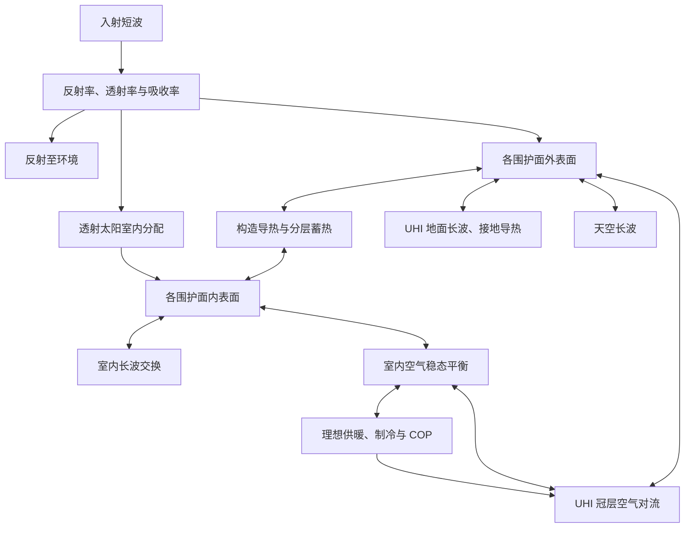

# Energy v7 与 UHI 逐时耦合（2026-10-20 重建版）

本分支从 `main` 的 `f3ebedb434d96245dc245871550eef6bf5e9f7bc` 重建。
此前交付 ZIP 与 v6/v7 Go 源码已不可访问，因而本分支不是旧 ZIP 的逐字恢复。
以下模型和验证结果均以本分支实际源码及复现脚本为准。

## 使用

安装 Python 依赖与 Go 1.22+。如 Go 不在 PATH，可设置 `CETUS_GO` 为其可执行文件绝对路径。
首次调用自动编译本机 Energy 内核；Linux RAD 也会从现有 Go 源码编译。
旧 `energy_model=None` 与 `energy_model="steady"` 入口保留。

```python
from ENERGY import Neighborhood
from ENERGY.coupled import simulate_coupled

# n 已有 buildings、site、climate 与可选 RAD 缓存
result = n.uhiSimulation(
    energy_model="v7", preheat=4,
    energy_kwargs={"output_dir":"outputs/coupled_run", "max_preheat":120},
)
state = result["coupled"]["final_state"]

# 下一段必须紧接上一段 HOY，使用同一建筑、场地和求解配置
continued = simulate_coupled(next_n, initial_state=state, preheat=0)
```

独立 Energy 内核使用 `ENERGY.surface.SurfaceEngine`。持久 JSON 流支持单个建筑请求和
`{"batch":[...]}`；`{"models":[...]}` 缓存静态构造，后续
`{"use_models":true,"batch":[{"hours":[...],"initial_state":[...]}]}`
只传当前边界和显式状态。`trial=true` 返回全区空气、地面反馈和，减少根求解 IO。
进程仅缓存配置，不保存建筑物理时间状态。JSON 数值以双精度传输。

```bash
python -m pip install -r requirements.txt
python -m unittest discover -s tests -v
cd ENERGY/surface_engine
go test -race ./...
# 独立构建（Linux/macOS）；Windows 输出名称使用 .exe
go build -o ../bin/CetusSurfaceEnergy .
```

## 热网络与符号

墙、屋面、地板可包含任意串联层。每层以中点集中热容表示，构造两端有独立的无热容
表面节点。层间导热采用相邻半层热阻之和。未给分层时，使用一个中点热容与两侧各半热阻。
窗、天窗只有内外表面及构造热阻，所有热容严格为零。
室内空气和室内辐射交换节点均无热容；室内为单热区、理想恒温器死区模型。



正值 `hvac_w` 为供暖；负值为制冷。
`hvac_to_air_w = -hvac_w + electricity_w`，供暖可为负。
`convection_to_air_w`、`ventilation_to_air_w`、`longwave_to_ground_w`、
`contact_to_ground_w` 均以建筑流向环境为正。
`storage_w = Σ C(Tnew−Told)/dt`，`storage_delta_kwh = storage_w*dt/3.6e6`，
为该时段新增储能，可正可负；逐小时输出中窗、天窗两者都为零。

建筑总账为：

```
吸收短波 + 透射短波 + 内部得热 + HVAC
= 对流至空气 + 换气至空气 + 长波至天空 + 长波至地面 + 接地导热 + 蓄热
```

恒温器自由运行、供暖及制冷试算固定同一个上一小时状态。
当前小时的 Energy–UHI 根求解也固定同一个上一小时建筑、空气和地层状态。
根求解同时更新建筑长波、UHI 地面长波和对流，并检查空气与三个地层方程残差。
任何未收敛小时或预热失败均抛出异常，不提交调用者的气候或建筑状态。

## UHI 侧归属与面积

耦合路径中 UHI 仅保留道路、裸地、绿地、水面：

- 暴露地表占场地比例之和为 `1−建筑覆盖率`，不重新归一到 1；屋顶不再参与 UHI 地表换热或蓄热。
- 建筑短波不进入 UHI 的 `QS`，建筑吸收、透射均在 Energy 计一次。
- UHI 暴露地面采用逐时原始太阳输入，其时间响应由原有地层热容承担；不叠加 CTTC 太阳延迟。
- 建筑长波、接地导热在 UHI 以等量相反符号计入。建筑反馈先求整栋建筑 W，再除场地面积。
- 建筑接收暴露地面面积加权温度；返回地面热量按暴露面积分配，这是集中地面接收器近似。
- Energy 外对流使用 `5.8+4.1*Uref`，其中 `Uref` 沿用 UHI 风速削减公式；显式覆盖 `ho_w_m2k` 时使用覆盖值。
- UHI 冠层与地层热容、深层导热和对流函数沿用仓库实现。交通得热独立计入；不再添加经验建筑空调热源。
- 旧 UHI 蒸发保留为冠层显热负源项，未求解空气湿度。耦合屋顶没有水分模型，停用原绿屋顶蒸发项，避免重复归属。

`readSHP(fvc=..., fwc=...)` 同时修复原有面积预算：指定绿地、水面后，道路与裸地
按原二者比例分配剩余面积；负剩余面积拒绝计算。

## 参数约定与可覆盖项

```python
options = {
  "surfaces": {
    "wall": {"u_value_w_m2k":0.5, "thermal_mass_j_m2k":60000,
             "reflectance":0.26, "emissivity":0.9},
    "roof": {"u_value_w_m2k":0.4, "thermal_mass_j_m2k":80000,
             "reflectance":0.5, "emissivity":0.9},
    "window": {"u_value_w_m2k":2.1, "reflectance":0.15,
               "transmittance":0.65, "emissivity":0.84,
               "absorbed_inside_fraction":0.5},
  }
}
```

- `thermal_mass_j_m2k` 为有效面热容 J/(m² K)，不是材料质量 kg。
- `layers` 是从外至内的 `resistance_m2k_w` 与 `capacity_j_m2k` 列表；指定后层热容优先，单热容置零。
- `u_convention="air_to_air"` 默认从 `1/U` 中去掉参考膜热阻；也可使用 `surface_to_surface`，或直接覆盖构造 `resistance_m2k_w`。
- 默认参考膜：墙/窗内侧 .13，屋面 .10，地板 .17；外侧 .04 m² K/W。参考膜只剥离一次，实际外对流与长波另算。
- 原模板没有屋面和地板 U，默认沿用 `WallUValue`，可分别覆盖。
- 默认墙/屋面有效面热容 60000，地板 120000 J/(m² K)，仅为初始假设，未按项目构造校准。
- 原模板只有 SHGC，默认作为零吸收的有效透射（ρ=1−SHGC），不会额外叠加另一项 SHGC 得热；这不代表真实玻璃光学参数。
- 提供真实 ρ、τ 后 α=1−ρ−τ；吸收热按 `absorbed_inside_fraction` 分给内外表面，由热网络计算去向；无额外 SHGC 项。
- 默认墙/窗天空、地面视因子各 .5；屋面/天窗天空为 1。室外接收器采用黑体辐射温度，未建立建筑间辐射矩阵。
- 室内透射太阳按地板优先比例和表面积分配，室内长波用无热容辐射交换节点近似；未模拟逐次短波反射。
- 地板分支仅表示接地地板；中间楼板的额外蓄热尚未单独建模。
- 潜热负荷、空调启停与功率限制、复杂多热区均不在该单热区模型内。

## 预热与连续运行

仅序列起点重复第一个完整自然日。`preheat` 为最少周期，`max_preheat` 为上限，
周期末所有建筑节点、空气和地层状态最大变化须不高于 `warmup_tolerance_k`（默认 .02 K）。
内部小时总账仍须满足热流容差。预热能量不计入正式结果。连续多日沿用上一小时状态，
不在每日重新初始化。恢复必须显式传入配置签名相同、HOY 紧接的 `initial_state`，并设 `preheat=0`。

## 复现附件测试与四案例回归

```bash
python scripts/run_coupled_case.py \
  --input-zip validation/coupled_input/53695_3092_LCZ1_2B.zip \
  --output outputs/coupled_run
python scripts/validate_surface.py
```

附件脚本使用 EPW 最热日开始的三天、建筑抽样种子42、10%精确射线与其他建筑插值。
天空为可移植的“各向同性散射＋最近 Tregenza patch 太阳束”，逐时水平总辐射归一至 EPW，
不等同于 Radiance Perez 天空。默认 `--climate-zone 4` 是测试建筑模板设置，可显式修改。
SHP 与 EPW 地点不同，属于给定几何置于该 EPW 天气下的数值测试，不是实测验证。
预热阶段每轮写入 `warmup_checkpoint.json`；运行环境中断后，可使用相同参数、
同一输出目录与 `--resume-warmup` 继续预热。也可用 `--radiation-cache` 指定既有 RAD 文件，
无需重新执行辐射采样。检查点仅用于预热，正式时序继续使用 `state.json`。

详细结果见 [本次验证报告](energy_v7_validation.md)。
