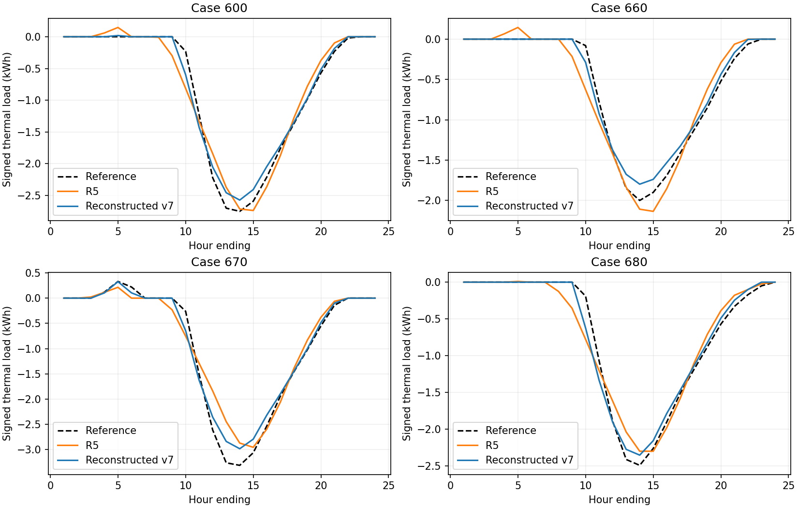

# Energy v7 / UHI 重建版验证（2026-10-20）

本次代码从 GitHub `main@f3ebedb` 重建，未取得上一轮 v7 ZIP 或本地提交
`7893558` 的源码。不能声称与旧包逐字相同，也不沿用旧包的 9/10 达标统计。

## 数值和状态检查

本次 Go 测试 10 项全部通过，`go test -race ./...` 和 `go vet ./...` 通过：
等温平衡、短波与建筑收支、连续/分段计算、试算不改变输入状态、零热容极限、
供暖热泵符号、分层构造、玻璃吸收，以及无效窗热容和光学参数拒绝。新增并行批量测试确认输出与顺序求解逐值相同。

Python 测试 7 项全部通过：

- 连续两天与分段恢复逐值一致，零建筑短波归属和窗零蓄热。
- 预热失败不改写调用者状态。
- 拒绝不连续 HOY 的恢复。
- 天窗面积从屋面中扣除、天窗零热容。
- 公共 `uhiSimulation(energy_model="v7")` 入口。
- 指定绿地、水面后的场地面积预算闭合。
- 独立 SciPy 非线性残差求解与 Go 节点温度对照，以及缓存/精简试算与完整 IO 的一致性。

独立 SciPy 检查使用三个太阳辐照度条件，最大节点温差 **3.031×10⁻¹⁰ K**。
源测试在 `test/` 与 `test/native/energy/main_test.go`，运行记录在
`test/validation/rebuilt_results/`。

## 可恢复 ASHRAE 140 四案例对照

找回了 R5 交付包中的 600、660、670、680 七月逐时输入和 7 月 14 日参考负荷。
每例连续运行 744 h，序列开始重复首日预热至周期末状态变化小于 .001 K（3 周期）。
共 2976 h。没有使用 R5 全日短波重分配，没有进行参数寻优。

| Case | R5 RMSE（kWh） | 本次重建 RMSE（kWh） | 原 RMSE 上限（kWh） | 本次 PCC | 结果 |
|---|---:|---:|---:|---:|---|
| 600 | 0.191662 | 0.122926 | 0.1921 | 0.994695 | 达到所选判据 |
| 660 | 0.169313 | 0.095012 | 0.1697 | 0.995224 | 达到所选判据 |
| 670 | 0.286336 | 0.165100 | 0.3018 | 0.995497 | 达到所选判据 |
| 680 | 0.189843 | 0.120422 | 0.2097 | 0.991008 | 达到所选判据 |

PCC 下限沿用 R5 记录的 .879；负荷为整热区逐小时显热能量，供暖正、制冷负。
全部案例最大建筑收支残差低于 **4.55×10⁻⁷ W**。

这些数据和原始转换脚本保存在 `test/validation/ashrae_recovered/` 与
`test/scripts/validate_surface.py`，压缩输入使用 gzip，SHA-256 清单保存在 `test/validation/`。

本次对照有明确边界：

1. 找回的输入已经提供“透射得热”和“玻璃吸收向内得热”。为避免杜撰玻璃光学数据，
   本次回归沿用这些已给定太阳源项，窗的额外光学透射设零；它检验围护结构热惯性和室内负荷，
   不能替代真实窗光学参数驱动的标准整链验证。真实光学路径另有独立守恒测试。
2. 分层面热容采用脚本显式列出的轻质构造假设，构造总热阻沿用找回输入。
   未将这些参数重新核对到完整标准构造表。
3. 天气尚未与标准文件逐字段核对；初始化为首日周期预热，不是上一轮 1–7 月连续计算。
4. 本次没有恢复 900 和冬季参考/输入，未复测这些项目。

因此，本报告称为“可恢复四案例所选参考判据检验”，不能称为完整 ASHRAE 140 符合性验证。

## SHP＋EPW 全区耦合测试

输入：`53695_3092_LCZ1_2B.zip`，SHA-256 `959bf469dbc20cce63590755f1312aff236a666d3621af0f895fe1d693970f0c`。
使用全部 **756 栋建筑**，从 HOY 5136 开始连续计算 **72 h**（最热日开始的三天）。
预热重复第一个自然日 **108 个周期**，相邻周期末最大节点温差达到 **0.01979 K**，
低于 .02 K 判据。该值是相邻周期变化，并非每个温度相对无限周期解的绝对误差。

| 检查 | 本次结果 |
|---|---:|
| 正式小时收敛 | 72/72 |
| 最大耦合方程残差 | 4.7612635e-06 W/m² |
| 最大单建筑热收支残差 | 0.00018222025 W |
| 最大短波反射/吸收/透射分账残差 | 0 W |
| 窗/天窗蓄热 | 严格为 0 |
| UHI 侧建筑短波 | 严格为 0 |
| 相对 EPW 平均增温 | 3.0709 K |

逐时数据、参数抽样清单、预热历史及可恢复的期末状态保存在 `test/validation/coupled_case/`。
完整逐建筑表面时间序列由复现脚本输出为 `outputs/.../building_hourly.json`；
大体积辐射缓存和可再生成的完整逐建筑结果不放入源码版本库。

需要保留的解释边界：

- SHP 位于约 38.35°N、114.68°E；EPW 为龙岩 25.10°N、117.017°E。
  本测试是给定城市几何在该天气下的计算，不是该地块的实测验证。
- 精确射线只采样 10% 建筑，其余插值，种子42；天空采用各向同性散射与最近 Tregenza patch 太阳束，非 Perez 模型。
- 模板随机抽样产生 **19 栋墙 U<0.1 W/(m² K)** 的建筑，最小值为 **0.00685086 W/(m² K)**。
  本次保留这些样本而未截断其低值尾部；这一参数尾部与较大的热容共同造成很慢的预热收敛。
  真实应用应先核对构造参数分布，不宜把此默认抽样直接视为当地真实建筑存量。
- 本次修复了显式绿地/水面覆盖率下的场地面积预算，并使用重建版的参数与数值配置。
  旧 v7 包不可访问，无法做旧包逐值回归。本文只报告本次实际计算值。
- 温度与负荷参数未经实测校准；数值守恒和收敛不能证明城市热环境预测已得到独立验证。
